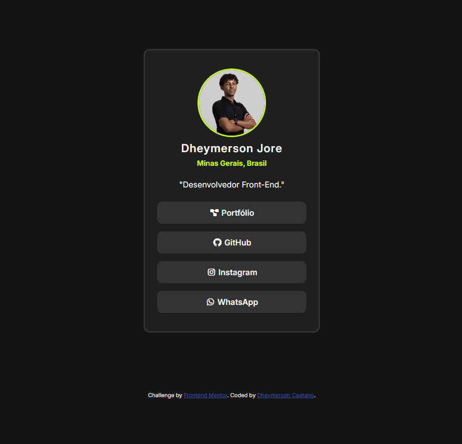

# Social Links Profile

Um perfil de links sociais com uma interface moderna, simples e responsiva, reunindo diferentes redes sociais em um único lugar.

## Prévia



## Demonstração

Acesse a versão publicada do projeto:

**[Visualizar projeto online](https://jore-x.github.io/social-links-profile/)**
## Funcionalidades

- Layout responsivo para diferentes tamanhos de tela.
- Interface limpa e minimalista.
- Links para redes sociais.
- Efeitos de interação ao passar o mouse sobre os elementos.

## Tecnologias utilizadas

- HTML5
- CSS3
- Flexbox
- Design responsivo (Responsive Web Design)

## Como executar o projeto

Para executar o projeto localmente, siga os passos abaixo:

1. Clone este repositório:

   ```bash
   git clone https://github.com/Jore-X/social-links-profile.git
   ```

2. Acesse a pasta do projeto:

   ```bash
   cd social-links-profile
   ```

3. Abra o arquivo `index.html` no navegador.

## Estrutura do projeto

```text
social-links-profile/
├── assets/
│   └── images/
├── index.html
├── style.css
└── preview.png
```

## Aprendizados

Durante o desenvolvimento deste projeto, pratiquei conceitos fundamentais de desenvolvimento front-end, como:

- Estruturação de páginas com HTML.
- Estilização de interfaces com CSS.
- Criação de layouts responsivos.
- Implementação de efeitos de interação com CSS.

## Autor

**Jore-X**

- GitHub: [@Jore-X](https://github.com/Jore-X)
- Repositório: [Social Links Profile](https://github.com/Jore-X/social-links-profile)

---

Desenvolvido com HTML e CSS.
